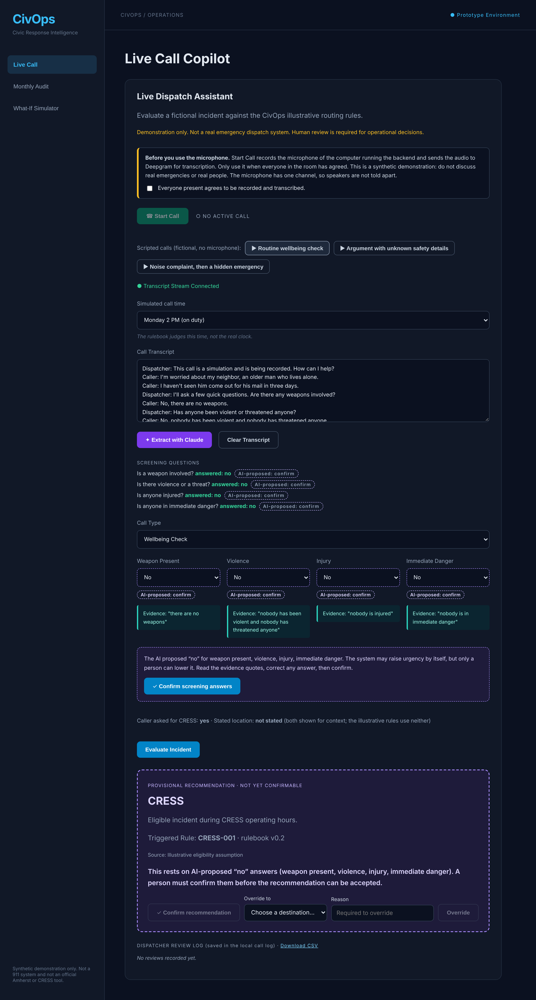
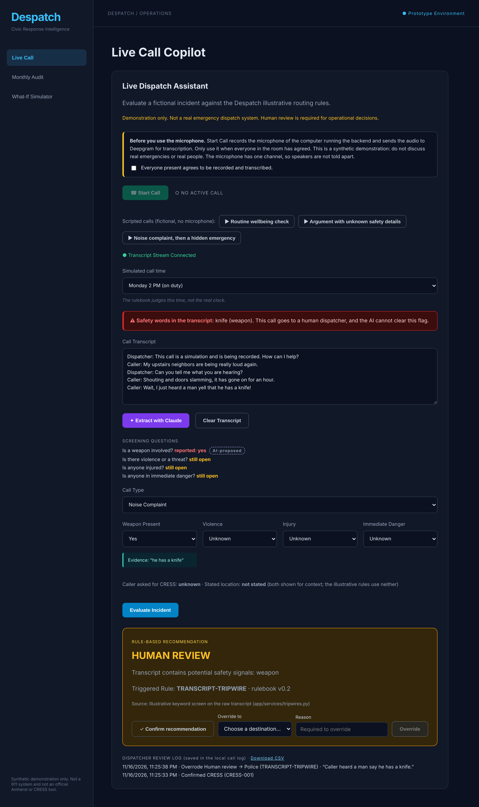
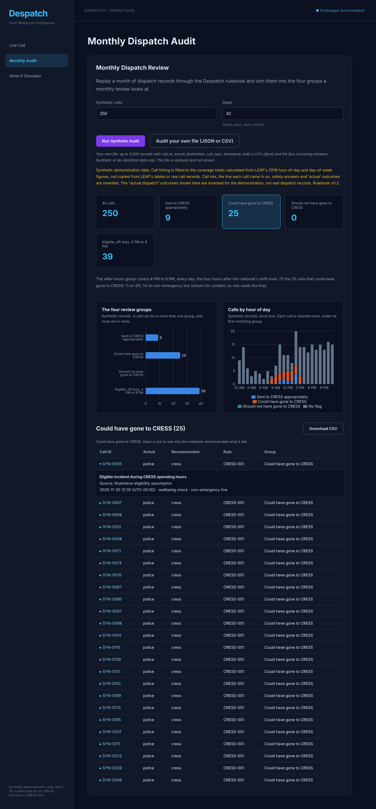
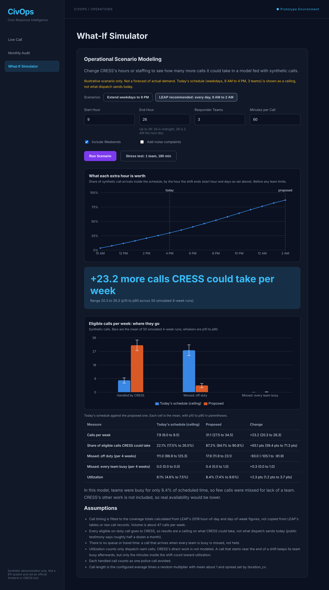
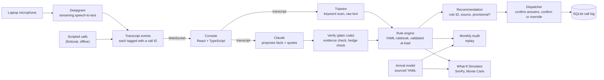

# CivOps

[](https://github.com/doorukb/CivOps/actions/workflows/ci.yml)

**Decision support for routing non-emergency calls to community responders, built so that a language model can inform a dispatcher but can never be the one who decides.**

Amherst, Massachusetts runs CRESS, an unarmed community-responder service meant to take calls that do not need police. Local reporting has described how few calls dispatch actually sends to it
([Daily Hampshire Gazette, "First look at how little Amherst's police alternative being used called troubling"](https://www.gazettenet.com/Minimal-dispatch-initiated-calls-for-CRESS-responders-raising-concerns-for-Amherst-oversight-committee-54779483);
[Gazette, "Year-end report shows Amherst CRESS still not being dispatched"](https://www.gazettenet.com/Year-end-report-shows-Amherst-CRESS-still-not-being-dispatched-59502566)).
Deciding in the middle of a call whether it is safe to send unarmed responders is a hard judgement to make quickly and consistently. CivOps writes an illustrative version of the routing rules down as software and uses it at three moments: **during a call**, **after a month of calls**, and **before a staffing decision**.

> **Synthetic demonstration only.** This is not a 911 system and not an official Town of Amherst or CRESS tool. It has no affiliation with either. The rulebook is illustrative, all data is synthetic, and a human reviews every recommendation. See [Responsible use](docs/RESPONSIBLE_USE.md).

Built at HackUMass XIV by Doruk Bilge and Renan Solak.

## What it looks like

| Live Call: a routine call | Live Call: a hidden emergency |
|-|-|
| [](docs/img/live-call-provisional.png) | [](docs/img/live-call-tripwire.png) |
| The model proposed four "no" answers, each with a quote. The recommendation stays **provisional** until a person confirms them. | A safety word in the transcript sends the call to a human. Nothing the model extracted can clear it. The override records what was chosen and why. |

| Monthly Audit | What-If Simulator |
|-|-|
| [](docs/img/monthly-audit.png) | [](docs/img/what-if-simulator.png) |
| A synthetic month replayed through the rulebook and sorted into four review groups. | Today's schedule against a proposed one, over 50 seeded simulated runs. |

Screenshots are of the running app with synthetic data. No API key was available when they were captured, so the "Extract with Claude" step was answered from the hand-written fixture in `backend/eval/fixtures/demo_scripts.json`; everything else on screen is the real backend ([capture script](docs/img/capture-screenshots.cjs)).

## The three modules

| | What it does |
|-|-|
| **Live Call** | Streams a transcript (laptop microphone through Deepgram, or a scripted call). A keyword tripwire screens the raw text as it arrives. When the call ends, Claude proposes the call type and four screening answers, each with an evidence quote; plain code checks the quotes. The rulebook then recommends a destination and cites the rule. The dispatcher confirms or overrides, and the outcome is written to a local SQLite log. |
| **Monthly Audit** | Replays a month of records (a seeded synthetic month, or your own JSON/CSV file) through the same rulebook and sorts them into four groups: sent to CRESS appropriately, could have gone to CRESS, should not have gone to CRESS, and eligible in the hours just after the shift ends. |
| **What-If Simulator** | A SimPy discrete-event simulation of responder teams. It compares today's schedule with a proposed one over 50 seeded Monte Carlo replications and reports mean and p10 to p90 for calls handled, calls missed off duty, calls missed because every team was busy, and utilization. Schedules may run past midnight, so LEAP's recommended 9 AM to 2 AM can be modelled. |

## Design principles

These are the point of the project, and each is enforced in code and pinned by tests.

1. **The model extracts facts. Plain code decides.** Claude never sees the rulebook and never names a destination. `rule_engine.py` walks a YAML rulebook in a fixed order and returns the first outcome that applies, with the rule's ID, its source and the rulebook version.
2. **A tripwire the model cannot clear.** A keyword scan runs on the raw transcript before anything the model said is looked at. A match sends the call to a human, whatever was extracted.
3. **Unknown is never "no".** Every answer starts unknown. An unanswered question, an unverifiable quote or malformed model output all route to human review (`SCREEN-INCOMPLETE`).
4. **Autonomy in one direction only.** The system may raise urgency by itself; lowering it takes a person. A "no" that only the model stands behind makes a CRESS recommendation *provisional*: the server refuses to record it as confirmed until a dispatcher has confirmed those answers. A hedged denial ("I don't think so", "not that I know of") is reset to unknown by a deterministic check, not by prompt wording.
5. **Escalation means a human, never police.** Every safety path ends in `human_review`. The rulebook loader rejects a file in which a safety outcome goes anywhere else, or in which any rule routes to police, fire/EMS or a crisis line.
6. **Evidence or it did not happen.** A true/false answer is kept only if its quote appears in the transcript. This proves the words were said, not what they mean, which is why principle 4 exists.
7. **Say what is synthetic.** Every screen, API response and data file says what is invented, fitted or unverified.

Details: [Architecture](docs/ARCHITECTURE.md) · [Rulebook](docs/RULEBOOK.md)

## Architecture



Backend: Python 3.13, FastAPI, Pydantic, SimPy, standard-library `sqlite3`. Frontend: React 19, TypeScript, Vite, Recharts. One model call per call, for extraction only (Claude Haiku, through the Anthropic SDK's structured-output parsing).

## Evaluation

All evaluation data is synthetic and hand-written, and every set is small. The honest summary:

| Evaluation | Result | What it does not show |
|-|-|-|
| **Disguised emergencies, v1** (27 cases with no tripwire word; run 2026-11-15 on `claude-haiku-4-5`) | The model recognised **22 of 27 = 81%** (Wilson 95%: 63% to 92%). The other 5 reached a human only because screening was incomplete. **0 of 27** were routed to CRESS (Wilson 95%: 0% to 12%). | There were no benign controls, so a system that escalates everything would score the same. The cases are unscreened paragraphs, which reach human review whether they are dangerous or not. |
| **Matched pairs, v1** (11 Suspicious-call pairs differing in one demographic detail, 3 runs each) | Extracted fields matched between the two versions in 26 of 33 comparisons (79%), the same as the same-text noise floor (52 of 66, 79%). | **Nothing about routing.** All 66 extractions ended at `SCREEN-INCOMPLETE`, so the decision could not differ. This is an extraction-variability smoke test, not a bias audit. |
| **v2 sets** (40 emergencies plus benign controls; 16 dialogue pairs where routing can differ; 40 hand-labelled calls for per-field extraction accuracy) | **Pre-registered, not yet run.** Cases, labels and scoring are committed and unit-tested; the paid runs have not been made. | Everything, until they are run. |

Things that are verified today, without a model:

- **The rulebook is complete.** One test enumerates 6 call types x 81 screening patterns x 336 half-hours of a week = **163,296 inputs** and asserts that each gets exactly one rule, that only CRESS, CRESS follow-up or human review can come out, that a "yes" always escalates, and that CRESS is only reachable with four "no" answers.
- **The deterministic checks hold in the worst case.** If the model obeyed an injected instruction and returned "all clear" with made-up quotes, every answer is discarded. If it answered "no" on each of the eight hedged denials in the gold set, each is reset to unknown.
- **The demo is regression-tested offline.** A stored extraction for each scripted call is replayed through the checks and the rulebook at three simulated times on every commit.

Full detail, including how to run the paid sets: [Evaluation](docs/EVALUATION.md).

## Run locally

Needs Python 3.13 and Node.js 22. Run the backend and the frontend in two terminals.

macOS / Linux, with `make`:

```bash
make setup    # virtualenv, Python and npm dependencies, backend/.env from the example
make dev      # backend on :8000 and frontend on :5173
```

Then open http://localhost:5173. `make help` lists the other targets (`test`, `lint`, `demo`, `eval-check`).

### Backend by hand (from `backend/`)

Windows PowerShell:

```powershell
python -m venv .venv
.\.venv\Scripts\Activate.ps1
pip install -r requirements.txt
copy .env.example .env   # then fill in ANTHROPIC_API_KEY and DEEPGRAM_API_KEY
python -m uvicorn app.main:app --reload
```

macOS / Linux:

```bash
python3 -m venv .venv
source .venv/bin/activate
pip install -r requirements.txt
cp .env.example .env     # then fill in ANTHROPIC_API_KEY and DEEPGRAM_API_KEY
python -m uvicorn app.main:app --reload
```

On Linux, **Start Call** also needs PortAudio (`sudo apt install libportaudio2` on Debian/Ubuntu). On macOS, allow microphone access for your terminal app when asked.

API docs: http://127.0.0.1:8000/docs.

### Frontend by hand (from `frontend/`)

```bash
npm ci
npm run dev
```

Open http://localhost:5173. Vite proxies `/api/*` and `/ws/*` to the backend on port 8000.

### What works without keys

| | No keys | `ANTHROPIC_API_KEY` | `DEEPGRAM_API_KEY` |
|-|-|-|-|
| Scripted calls, tripwire, rulebook, call log | yes | | |
| Monthly Audit, What-If Simulator | yes | | |
| "Extract with Claude" (otherwise fill the answers in by hand) | | needed | |
| Start Call (live microphone) | | | needed |

### Tests

```bash
make test          # backend (pytest) and frontend (vitest); no paid API calls
make lint
make eval-check    # validates the evaluation case files; free
```

Over 480 backend tests (98% line coverage of `backend/app/`; CI fails below 95%) and 77 frontend tests run on every push. No test needs a key or a microphone.

### Demo day

```bash
make demo
```

This starts the backend without `--reload` and bound to localhost. `--reload` restarts the server whenever a file changes, and a restart in the middle of a demo drops the transcript WebSocket. The walkthrough is in [Demo script](docs/DEMO.md).

## Scripted calls (no microphone needed)

A scripted call is the backup if the microphone, Deepgram or the Wi-Fi fails. The backend replays a fictional transcript through the same WebSocket path as a live call, so the tripwire banner, extraction and decision card behave the same way.

| Script ID | What it shows |
|-|-|
| `routine_wellbeing` | A wellbeing check with every safety answer clear → CRESS (or CRESS follow-up outside duty hours), provisional until the answers are confirmed |
| `hidden_knife` | A noise dispute that turns into a knife sighting → the tripwire sends it to human review |
| `incomplete_screening` | An argument with unknown safety details → `SCREEN-INCOMPLETE` |

You can also start a script from a terminal while the page is open (`curl.exe` on Windows); the page picks the call up when it starts:

```bash
curl -X POST "http://127.0.0.1:8000/scenarios/hidden_knife/play?speed=2"
```

`GET /scenarios` lists the scripts. `speed` speeds up playback (1 is real time, up to 100). Only one call or script runs at a time.

## Limitations

- **The rulebook is illustrative.** Three eligibility rules and four safety stages, written for this project. Every rule's `source` says so. It is not an official protocol.
- **"Calibrated to LEAP" is not claimed.** Call-arrival timing is *fitted* to coverage figures derived from LEAP's 2019 analysis, not copied from LEAP's tables. The data file and the API say `fitted` / `calibrated_to_leap: false`. See [Data](docs/DATA.md).
- **The simulator shows a ceiling.** It sends every eligible on-duty call to CRESS, with no queue and no travel time, so its numbers are the most CRESS could take in the model, not a forecast.
- **The evaluations are small and partly not yet run.** See the table above.
- **The tripwire is a keyword list.** It ignores negation ("he does not have a gun" still flags) and will miss an emergency described without any listed word. A flag only asks for a human look.
- **Evidence quotes prove the words were said, not what they mean.** A real quote can back a wrong answer. That is why a model-proposed "no" must be confirmed by a person.
- **The live path is a microphone, not a phone line.** One channel, no speaker labels, no telephony.
- **Two fields are display-only.** "Caller asked for CRESS" and the stated location are extracted and shown; no rule reads them. The line a call came in on (911 or non-emergency) is recorded in audit data only.
- **Localhost only, no login.** The backend refuses requests from other origins and other host names, but any program on the same machine can call it. Never bind it to `0.0.0.0` or put it behind a tunnel.

More in [Status](docs/STATUS.md).

## Future work

- Transcribe LEAP's hour-of-day and day-of-week tables into `backend/app/data/arrival_model.yaml` (a data-only change) and re-derive coverage as an independent check.
- Run the pre-registered v2 evaluations and record real model output for the three scripted calls.
- Telephony (for example Twilio Media Streams) and speaker diarization, so the transcript knows who is speaking.
- Rule conditions for the line a call came in on and for "caller asked for CRESS", with the policy semantics agreed with the people who own them.
- Conformal abstention for extraction, and a caller-facing voice intake.
- Rulebook versioning with a change log, so an audit can be replayed against the rules in force at the time.

## Documentation

| | |
|-|-|
| [Status](docs/STATUS.md) | What is implemented, known limitations, what is next |
| [Architecture](docs/ARCHITECTURE.md) | Components, data flow, the event protocol, the threat model |
| [Rulebook](docs/RULEBOOK.md) | The YAML schema, evaluation order, how to add a rule |
| [Evaluation](docs/EVALUATION.md) | What each evaluation measures, results with provenance, limits |
| [Data](docs/DATA.md) | Every data source, what is real, what is synthetic |
| [Demo script](docs/DEMO.md) | A three-minute walkthrough and the offline backup |
| [Responsible use](docs/RESPONSIBLE_USE.md) | What this is not, consent, where data goes |

## License

[MIT](LICENSE).
